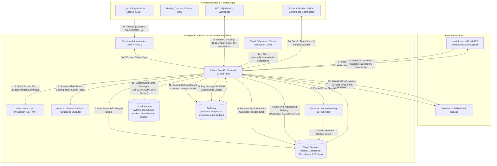

# Technical Requirements Document (TRD): Prisk AI
**Meeting Pulse, Group Sentiment & Enterprise Risk Analytics Platform**

- **Version:** 1.0.0
- **Status:** Approved for Implementation
- **Source PRDs:**
  - [prd/prd.md](file:///Users/glorypuncuna/Study/priskAI/prd/prd.md) (Meeting Pulse & Persona Analytics)
  - [prd/registration_prd.md](file:///Users/glorypuncuna/Study/priskAI/prd/registration_prd.md) (User Authentication & Registration)
  - [prd/risk_mitigation_prd.md](file:///Users/glorypuncuna/Study/priskAI/prd/risk_mitigation_prd.md) (Enterprise Risk & Mitigation Module)
- **Domain Glossary:** [GLOSSARY.md](file:///Users/glorypuncuna/Study/priskAI/GLOSSARY.md)
- **Architecture Decision Records:**
  - [ADR-0001: Ephemeral Speaker-to-Group Mapping and Speaker-Blind Sentiment Scoring](file:///Users/glorypuncuna/Study/priskAI/docs/adr/0001-group-only-persistence-and-ephemeral-speaker-mapping.md)
  - [ADR-0002: Post-Meeting DLP Scrubbing and Transcript-Only MeetStream Ingestion](file:///Users/glorypuncuna/Study/priskAI/docs/adr/0002-post-meeting-dlp-and-transcript-only-ingestion.md)
  - [ADR-0003: Gemini Structured Rubric Outputs for Explainable AI](file:///Users/glorypuncuna/Study/priskAI/docs/adr/0003-gemini-structured-rubric-for-xai.md)
  - [ADR-0004: Firestore Native Vector Search for Few-Shot Corrected Context](file:///Users/glorypuncuna/Study/priskAI/docs/adr/0004-firestore-native-vector-search-for-few-shot-context.md)
  - [ADR-0005: Human-Gated Risk Promotion Before Escalation SLA Activation](file:///Users/glorypuncuna/Study/priskAI/docs/adr/0005-human-gated-risk-register-and-escalation-sla.md)
  - [ADR-0006: Firebase Identity Platform for User Authentication and Extended Profile Storage](file:///Users/glorypuncuna/Study/priskAI/docs/adr/0006-firebase-identity-platform-with-firestore-user-profile.md)
  - [ADR-0007: Cryptographically Verifiable Compliance Audit Packages with WORM Cloud Storage](file:///Users/glorypuncuna/Study/priskAI/docs/adr/0007-cryptographic-compliance-audit-packages-with-worm-retention.md)

---

## 1. System Architecture & Technology Stack

### 1.1 High-Level Architecture Overview

Prisk AI is architected as a cloud-native, cost-optimized serverless application on **Google Cloud Platform (GCP)** using **React.js** for the frontend and **Python FastAPI** on **Cloud Run** for the backend.



### 1.2 Core Technology Stack

| Layer | Technology | Rationale & Configuration |
| :--- | :--- | :--- |
| **Frontend** | React 18+ (TypeScript, Vite), Tailwind CSS, TanStack Query, Zustand | Fast SPA with WCAG 2.1 AA compliance (`NFR-4.1`), optimistic UI updates for `<50ms` slider reactivity (`Story 3.3`), responsive international phone inputs with country code selector (`FR-0.2`), and quarantined onboarding states (`ADR-0006`). |
| **Charting & Layout** | Recharts + `react-grid-layout` + `html-to-image` | Interactive line charts with clickable drill-down nodes (`FR-4.1`, `FR-4.2`), 5x5 Risk Heatmap matrices (`FR-7.2b`), customizable drag-and-drop resizable widgets (`FR-4.7`, `FR-7.4`), and client-side `PNG` export (`FR-4.5`). |
| **Backend Runtime** | Python 3.12 + FastAPI (Async) on Google Cloud Run | Auto-scaling serverless container (`min-instances: 1` during business hours for `99.9%` uptime `NFR-3.2` and zero cold-start latency on webhooks). |
| **Authentication & RBAC** | Firebase Authentication (Google Identity Platform) + `phonenumbers` | Manages Email/Password, OAuth 2.0 / OIDC social login providers (`FR-0.1`), managed Argon2/scrypt password hashing, and user registration (`FR-0.2`). Validates international E.164 phone formats server-side. Enforces 4 RBAC tiers (`EXECUTIVE`, `MANAGER`, `ADJUDICATOR`, `EXTERNAL_STAKEHOLDER`) via custom claims, defaulting self-registered accounts to `EXTERNAL_STAKEHOLDER` (`FR-0.3`, `FR-7.5`, `ADR-0006`). |
| **Operational & Vector DB** | Google Cloud Firestore (Native Mode) | Stores user profiles (`users/{uid}`), projects, meetings, dialogue blocks, risk register records (`risk_register`), compliance audit package metadata (`compliance_packages`), and 768-dim `Corrected Context` vectors using Firestore Native Vector Search (`find_nearest`, \$0 idle cost). |
| **Compliance Artifact Storage** | Google Cloud Storage (Bucket: `prisk-compliance-packages`) | Dedicated GCS bucket configured with Object Retention (Write Once, Read Many / WORM policy) to store immutable, cryptographically verifiable multi-framework compliance packages (PDF, CSV, JSON) with SHA-256 checksums (`FR-7.1d.3`, `ADR-0007`). |
| **Analytical & Audit Warehouse** | Google BigQuery | Powers `<3s` historical dashboard rendering across 1,000+ meetings (`NFR-1.2`), cross-project portfolio heatmaps (`FR-7.4`), and immutable append-only compliance/adjudication audit logs with SHA-256 package checksum verification (`NFR-2.4`, `FR-7.1d.3`, `FR-7.6`). |
| **PII Redaction** | Google Cloud DLP (`projects.content.deidentify`) | Executed once post-meeting in memory (`<200ms` per batch) before database persistence or LLM inference (`NFR-2.3`, `ADR-0002`). |
| **AI & Embeddings** | Vertex AI `gemini-2.5-flash` + `text-embedding-004` | Enterprise boundary guarantee (zero foundational model training on customer data). Enforces JSON Schema Structured Outputs for baseline scoring, MoM, Risk discovery, and on-demand Rubric Attributions (`ADR-0003`). |
| **Background Jobs** | Google Cloud Scheduler | Invokes FastAPI internal cron endpoint every 15 minutes to evaluate 24h/48h/72h risk escalation SLAs (`FR-7.3`) and systemic risk spike thresholds (`FR-7.4c`). |
| **Report & Compliance Generation** | `WeasyPrint` (PDF) + Python `csv` / `json` + `html-to-image` (PNG) | Server-side styled PDF/CSV/JSON generation for 5-section compliance audit packages across ISO 31000, COSO, SOC 2, HIPAA, and GDPR with embedded SHA-256 signatures (`FR-7.1d.3`, `FR-7.1d.4`), and client-side PNG canvas export (`FR-4.5`, `FR-7.4`). |

---

## 2. Domain Model & Privacy-by-Architecture Rules

All implementation code, database schemas, and API contracts must strictly adhere to the canonical terms in [GLOSSARY.md](file:///Users/glorypuncuna/Study/priskAI/GLOSSARY.md) and the following architectural invariants:

1. **No Cross-Meeting Individual Profiling ([ADR-0001](file:///Users/glorypuncuna/Study/priskAI/docs/adr/0001-group-only-persistence-and-ephemeral-speaker-mapping.md)):**
   - Raw speaker names (`speaker_name`) and `Company` names remain visible in the transcript text for human readability.
   - However, when an Adjudicator assigns a `Speaker Account` (`speaker_account_id`) to a canonical `Group` (e.g., `"Client Legal"`), that mapping is applied automatically **only within that single meeting's adjudication session** (stored in ephemeral session state).
   - Across subsequent meetings, `speaker_account_id` is **never** automatically mapped to a `Group` from historical records; the Adjudicator must assign the `Group` for that session.
   - Once the `Golden Record` is committed, `speaker_account_id` is stripped from the analytical model so longitudinal trends (`FR-4.1`, `FR-6.2`) aggregate strictly by `Group`, `Project`, and `Company`.
2. **Speaker-Blind Sentiment Inference ([ADR-0001](file:///Users/glorypuncuna/Study/priskAI/docs/adr/0001-group-only-persistence-and-ephemeral-speaker-mapping.md)):**
   - Whenever `Dialogue Blocks` are sent to Vertex AI (`gemini-2.5-flash`) for sentiment scoring or `Rubric Attribution`, the `speaker_account_id` and raw speaker name are omitted from the prompt payload so the model scores strictly *what was said* without speaker-identity bias (`Trustworthy AI Pillar #1`).
3. **Project-Scoped Canonical Group Taxonomy (`FR-2.2`, `FR-2.5`):**
   - Each `Project` maintains a canonical list of allowed `Group` names (e.g., `["Client Executive", "Client Legal", "Client Engineering", "Delivery PMO"]`) to prevent naming drift across meetings.
   - Gemini 2.5 Flash auto-populates suggested `Group` and `Company` fields (`FR-2.5`) while explicitly leaving any individual participant `Name` field unpopulated.
4. **Post-Meeting Batch Ingestion, DLP & Verified Upstream Deletion ([ADR-0002](file:///Users/glorypuncuna/Study/priskAI/docs/adr/0002-post-meeting-dlp-and-transcript-only-ingestion.md)):**
   - Prisk AI never stores raw audio files (`Line 35`).
   - Live meeting capture and live transcription are managed autonomously by `meetstream.ai`. Prisk AI omits live in-meeting chunk webhooks, container in-memory buffers, and live SSE streaming during active calls.
   - Upon meeting conclusion, `meetstream.ai` emits a `meeting.completed` webhook. The complete transcript is scrubbed in a single batch pass via **Cloud DLP**, redacting sensitive PII (`CREDIT_CARD_NUMBER`, `US_SOCIAL_SECURITY_NUMBER`, `GOVERNMENT_ID`, `PHONE_NUMBER`, `STREET_ADDRESS`, `EMAIL_ADDRESS`, `IBAN_CODE`) while **preserving** `PERSON_NAME` and `Company` names.
   - The scrubbed transcript and structured `Dialogue Blocks` are persisted to Firestore in `PENDING_ADJUDICATION` status.
   - **Crucial Persistence Invariant:** FastAPI invokes the `meetstream.ai` API to permanently delete the upstream transcript **only after successful, verified persistence to Cloud Firestore**.
   - Gemini 2.5 Flash baseline scoring executes post-persistence, using top-5 Few-Shot retrieval from `corrected_contexts` or defaulting to pure **Zero-Shot** inference for cold-start projects or groups.
5. **User Account vs. Ephemeral Speaker Account Boundary ([ADR-0006](file:///Users/glorypuncuna/Study/priskAI/docs/adr/0006-firebase-identity-platform-with-firestore-user-profile.md), [GLOSSARY.md](file:///Users/glorypuncuna/Study/priskAI/GLOSSARY.md)):**
   - An authenticated **User Account** (`users/{uid}`) is an operator logging into the application via Email/Password or OAuth/OIDC, assigned a platform role (`EXECUTIVE`, `MANAGER`, `ADJUDICATOR`, `EXTERNAL_STAKEHOLDER`) and project scopes.
   - A **Speaker Account** is strictly an ephemeral participant identifier parsed from a meeting transcript. Speaker Accounts never possess login credentials, are mapped to Groups only in session memory, and are completely severed from persistent analytical storage once the Golden Record is committed.
6. **Group Personification Principle ([GLOSSARY.md](file:///Users/glorypuncuna/Study/priskAI/GLOSSARY.md), `FR-7.1b`):**
   - Sentiment scores, longitudinal health trajectories, and Risk Register entries are permanently attributed strictly to canonical functional **Groups** (e.g., "Client Legal & Compliance", "Executive Sponsors"), never to individual participants or personas.
   - This principle applies universally across all meeting sizes, including 1-on-1 meetings, without requiring minimum participant count thresholds.
7. **Cryptographic Compliance Immutability & Zero-Quote WORM Architecture ([ADR-0007](file:///Users/glorypuncuna/Study/priskAI/docs/adr/0007-cryptographic-compliance-audit-packages-with-worm-retention.md), `FR-7.1d`):**
   - Generated multi-framework compliance packages are stored under WORM retention in GCS, sealed with SHA-256 hashes, and registered in BigQuery.
   - **Zero Verbatim Quote Invariant:** Compliance audit packages contain strictly aggregate risk severity ratings, category tags, mitigation lifecycle statuses, and framework crosswalks—containing **zero verbatim participant dialogue quotes** and zero unmasked personal data.
   - Consequently, when a GDPR Article 17 Right to Erasure request purges operational records from Firestore and BigQuery, historical WORM compliance artifacts in GCS require no tampering or binary alterations, remaining 100% legally and architecturally compliant.

---

## 3. Data Architecture & Database Schemas

### 3.1 Cloud Firestore Collections (Operational Store)

#### Collection: `users/{uid}` (`FR-0.1` – `FR-0.3`, `ADR-0006`)
```json
{
  "uid": "usr_9a8b7c6d",
  "email": "sarah.chen@acme.com",
  "first_name": "Sarah",
  "last_name": "Chen",
  "phone_number": "+14155552671",
  "country_code": "US",
  "role": "EXTERNAL_STAKEHOLDER",
  "status": "ACTIVE",
  "assigned_project_ids": ["proj_9f8a7b6c"],
  "created_at": "2026-10-18T14:10:00Z",
  "updated_at": "2026-10-18T14:10:00Z"
}
```
> **Identity & Role Invariants (`ADR-0006`):**
> - Credentials, password hashing (Argon2 / scrypt), and OAuth 2.0 / OIDC sessions are managed directly by Firebase Identity Platform (`FR-0.1`).
> - `phone_number` is strictly validated and stored in **E.164** format using Google `libphonenumber` / Python `phonenumbers` (`FR-0.2`).
> - Newly self-registered accounts default to `EXTERNAL_STAKEHOLDER` with `assigned_project_ids = []` (`FR-0.3`).
> - Role changes or project assignment updates automatically push updated JWT custom claims (`role`, `assigned_projects`) via `firebase_admin.auth.set_custom_user_claims`.

#### Collection: `projects/{project_id}`
```json
{
  "project_id": "proj_9f8a7b6c",
  "name": "Core Banking Modernization",
  "company_name": "Acme Financial Corp",
  "canonical_groups": [
    "Client Executive Sponsor",
    "Client Legal & Compliance",
    "Client Engineering",
    "Internal Delivery Team"
  ],
  "alert_thresholds": {
    "pulse_drop_delta": 15,
    "minimum_pulse_score": 40,
    "escalation_enabled": true,
    "escalation_intervals_hours": [24, 48, 72]
  },
  "manager_uids": ["uid_mgr_01"],
  "created_at": "2026-10-18T00:00:00Z",
  "updated_at": "2026-10-18T00:00:00Z"
}
```

#### Collection: `meetings/{meeting_id}`
```json
{
  "meeting_id": "mtg_01j9xyz",
  "project_id": "proj_9f8a7b6c",
  "company_name": "Acme Financial Corp",
  "title": "Q4 Scope & Milestone Alignment",
  "scheduled_start_at": "2026-10-18T14:00:00Z",
  "ended_at": "2026-10-18T15:00:00Z",
  "golden_record_committed_at": "2026-10-18T15:22:10Z",
  "location": "Google Meet (meet.google.com/abc-defg-hij)",
  "meetstream_bot_id": "ms_bot_8821",
  "upstream_transcript_deleted": true,
  "status": "GOLDEN_RECORD",
  "assigned_adjudicator_uid": "uid_adj_04",
  "ephemeral_speaker_map": null,
  "overall_pulse_score": 62,
  "overall_confidence": 0.89,
  "group_pulse_scores": {
    "Client Legal & Compliance": {
      "pulse_score": 44,
      "block_count": 12,
      "top_liked_words": ["timeline", "clarity", "audit", "documentation", "milestone"],
      "top_disliked_words": ["delay", "ambiguity", "liability", "overrun", "unapproved"]
    },
    "Client Executive Sponsor": {
      "pulse_score": 78,
      "block_count": 8,
      "top_liked_words": ["progress", "demo", "roadmap", "alignment", "velocity"],
      "top_disliked_words": ["bottleneck", "resourcing", "deferral", "scope", "testing"]
    }
  },
  "mom": {
    "date_time": "2026-10-18T14:00:00Z",
    "location": "Google Meet",
    "title": "Q4 Scope & Milestone Alignment",
    "agenda": ["Review Phase 1 Sign-off", "Compliance Gate Review"],
    "topics_of_discussion": ["Data residency requirements", "UAT schedule compression"],
    "summary": "Executive sponsors expressed satisfaction with engineering velocity, but Client Legal raised concerns regarding UAT schedule compression and compliance sign-off.",
    "action_items": [
      {
        "action_id": "act_01",
        "description": "Deliver revised UAT compliance checklist",
        "owner_group": "Internal Delivery Team",
        "due_date": "2026-10-22"
      }
    ],
    "recommended_mitigations": [
      "Schedule dedicated working session with Client Legal before Friday gate review."
    ]
  },
  "model_metadata": {
    "model_version": "gemini-2.5-flash-001",
    "prompt_template_version": "v1.4.0",
    "dlp_template_version": "dlp-standard-v1"
  }
}
```
> **Note on `status` Lifecycle:** `SCHEDULED` $\rightarrow$ `LIVE` $\rightarrow$ `PROCESSING_POST_MEETING` $\rightarrow$ `PENDING_ADJUDICATION` $\rightarrow$ `GOLDEN_RECORD` (or `PURGED_CONSENT_REVOKED`). While in `PENDING_ADJUDICATION`, `ephemeral_speaker_map` holds `{"Speaker_1": "Client Legal & Compliance"}` for in-session auto-tagging (`Q1.1`), and is set to `null` upon `GOLDEN_RECORD` commit.

#### Subcollection: `meetings/{meeting_id}/dialogue_blocks/{block_id}`
```json
{
  "block_id": "blk_0014",
  "sequence_index": 14,
  "parent_block_id": null,
  "start_time_sec": 312.4,
  "end_time_sec": 328.9,
  "display_speaker_label": "Sarah Jenkins (Acme)",
  "ephemeral_speaker_account_id": null,
  "group_name": "Client Legal & Compliance",
  "company_name": "Acme Financial Corp",
  "optional_participant_name": null,
  "scrubbed_text": "We cannot sign off on the UAT deployment if the audit logs are delayed again. Reach my office at [PHONE_NUMBER] if we need an emergency review.",
  "ai_initial_score": 38,
  "ai_confidence": 0.91,
  "rubric_breakdown": {
    "emotional_valence": 8,
    "delivery_alignment": 7,
    "relationship_trust": 11,
    "momentum_commitment": 12
  },
  "final_pulse_score": 32,
  "is_human_overridden": true,
  "xai_attribution": {
    "computed_at": "2026-10-18T15:18:02Z",
    "attributions": [
      {
        "verbatim_phrase": "cannot sign off on the UAT deployment",
        "start_char": 3,
        "end_char": 40,
        "attribution_weight": -0.85,
        "rubric_dimension": "delivery_alignment",
        "rationale": "Explicit blocker statement halting milestone sign-off."
      },
      {
        "verbatim_phrase": "audit logs are delayed again",
        "start_char": 48,
        "end_char": 76,
        "attribution_weight": -0.72,
        "rubric_dimension": "relationship_trust",
        "rationale": "References repeated delivery delay ('again'), indicating erosion of trust."
      }
    ]
  }
}
```

#### Collection: `corrected_contexts/{correction_id}` (Firestore Native Vector Search)
Used for Story 3.3 / FR-2.7 dynamic Few-Shot retrieval:
```json
{
  "correction_id": "corr_8812a",
  "project_id": "proj_9f8a7b6c",
  "group_name": "Client Legal & Compliance",
  "scrubbed_text": "We cannot sign off on the UAT deployment if the audit logs are delayed again.",
  "embedding": "<Vector<768> from text-embedding-004>",
  "ai_initial_score": 38,
  "human_adjusted_score": 32,
  "rubric_breakdown": {
    "emotional_valence": 8,
    "delivery_alignment": 7,
    "relationship_trust": 11,
    "momentum_commitment": 12
  },
  "adjudicator_uid": "uid_adj_04",
  "created_at": "2026-10-18T15:22:10Z"
}
```
*Firestore Composite Vector Index:* `(project_id ASC, group_name ASC, embedding VECTOR<768, COSINE>)`.

#### Collection: `risk_register/{risk_id}` (`FR-7.1` – `FR-7.6`)
```json
{
  "risk_id": "RSK-2026-0042",
  "project_id": "proj_9f8a7b6c",
  "company_name": "Acme Financial Corp",
  "source_meeting_id": "mtg_01j9xyz",
  "associated_groups": ["Client Legal & Compliance"],
  "title": "UAT Sign-off Blocked by Audit Log Delays",
  "contextual_description": "Client Legal indicated UAT deployment sign-off will be withheld if audit log delivery slips again, following a 18-point drop in Group Pulse Score.",
  "trigger_source": "PULSE_DROP_AND_TRANSCRIPT",
  "status": "OPEN",
  "category": "COMPLIANCE",
  "impact_score": 5,
  "probability_score": 4,
  "severity_index": 20,
  "risk_owner_uid": "uid_mgr_01",
  "mitigation_plan": {
    "strategy": "Deliver interim audit schema documentation and conduct live walkthrough with Client Legal.",
    "review_cadence": "WEEKLY",
    "next_review_at": "2026-10-25T14:00:00Z",
    "qualitative_commentary": [
      {
        "author_uid": "uid_mgr_01",
        "timestamp": "2026-10-18T15:25:00Z",
        "comment": "Aligned with engineering lead to prioritize audit log export."
      }
    ]
  },
  "escalation_config": {
    "enabled": true,
    "sla_started_at": "2026-10-18T15:22:10Z",
    "last_escalated_tier_hours": 0,
    "custom_recipients": ["exec-escalation@prisk.ai"]
  },
  "created_at": "2026-10-18T15:03:00Z",
  "updated_at": "2026-10-18T15:25:00Z"
}
```
> **Taxonomy & Invariants (`FR-7.1b`, `FR-7.2c`, `ADR-0005`):**
> - **`category` Enum:** `FINANCIAL` | `OPERATIONAL` | `COMPLIANCE` | `STRATEGIC` | `RELATIONSHIP`.
> - **`status` Enum:** `DRAFT_PENDING_ADJUDICATION` | `OPEN` | `MITIGATED` | `CLOSED` | `ESCALATED` | `DISMISSED`.
> - **`associated_groups`:** Bound strictly to canonical `Group` names (per Group Personification, `GLOSSARY.md`), avoiding individual participant attribution.

#### Collection: `compliance_packages/{package_id}` (`FR-7.1d`, `ADR-0007`)
Stores metadata and structured representations of cryptographically verifiable compliance audit packages exported across ISO 31000, COSO, SOC 2, HIPAA, and GDPR:
```json
{
  "package_id": "CMP-2026-0089",
  "project_id": "proj_9f8a7b6c",
  "company_name": "Acme Financial Corp",
  "target_frameworks": ["ISO_31000", "SOC_2", "GDPR"],
  "format": "PDF",
  "sha256_hash": "e3b0c44298fc1c149afbf4c8996fb92427ae41e4649b934ca495991b7852b855",
  "storage_uri": "gs://prisk-compliance-packages/proj_9f8a7b6c/CMP-2026-0089.pdf",
  "generated_by_uid": "uid_mgr_01",
  "generated_at": "2026-10-18T14:15:00Z",
  "sections": {
    "header_metadata": {
      "package_id": "CMP-2026-0089",
      "timestamp": "2026-10-18T14:15:00Z",
      "organization_name": "Acme Financial Corp",
      "project_name": "Core Banking Modernization",
      "target_frameworks": ["ISO_31000", "SOC_2", "GDPR"],
      "generating_user": "Sarah Chen (uid_mgr_01)",
      "sha256_signature": "e3b0c44298fc1c149afbf4c8996fb92427ae41e4649b934ca495991b7852b855"
    },
    "control_mapping_table": [
      {
        "risk_id": "RSK-2026-0042",
        "framework": "SOC_2",
        "control_clause": "CC6.1 (Logical Access and System Operations)",
        "compliance_status": "MONITORED_IN_PROGRESS"
      },
      {
        "risk_id": "RSK-2026-0042",
        "framework": "ISO_31000",
        "control_clause": "Clause 6.4.3 (Risk Evaluation & Treatment)",
        "compliance_status": "MITIGATION_ACTIVE"
      }
    ],
    "sanitized_risk_register": [
      {
        "risk_id": "RSK-2026-0042",
        "title": "UAT Sign-off Blocked by Audit Log Delays",
        "category": "COMPLIANCE",
        "severity_index": 20,
        "impact_score": 5,
        "probability_score": 4,
        "status": "OPEN",
        "risk_owner_title": "Project Delivery Lead",
        "associated_groups": ["Client Legal & Compliance"]
      }
    ],
    "mitigation_lifecycle_summary": [
      {
        "risk_id": "RSK-2026-0042",
        "timestamp": "2026-10-18T15:22:10Z",
        "event_type": "RISK_PROMOTED_FROM_GOLDEN_RECORD",
        "actor_role": "ADJUDICATOR",
        "sla_target_hours": 24
      },
      {
        "risk_id": "RSK-2026-0042",
        "timestamp": "2026-10-18T15:25:00Z",
        "event_type": "MITIGATION_STRATEGY_ATTACHED",
        "actor_role": "MANAGER",
        "sla_target_hours": 24
      }
    ],
    "privacy_governance_attestation": {
      "dlp_scrubbing_attestation": "Scrubbed via Google Cloud DLP (100% compliant with ADR-0002)",
      "raw_audio_retention": "ZERO_AUDIO_STORED (meetstream.ai deleted upstream)",
      "explicit_consent_records": [
        {
          "meeting_id": "mtg_01j9xyz",
          "consent_mechanism": "Automated In-Meeting Bot Chat Consent Prompt",
          "status": "CONSENT_ACKNOWLEDGED"
        }
      ]
    }
  }
}
```

---

### 3.2 BigQuery Analytical & Governance Tables

To meet `NFR-1.2` (`<3s` dashboard load for 1,000+ meetings) and `NFR-2.4` / `FR-7.6` (immutable audit logs), FastAPI streams committed `Golden Records`, `Risk Register` state transitions, manual overrides, and exported compliance checksums into partitioned BigQuery tables:

1. **`prisk_analytics.fact_group_pulse_history`**
   - **Partitioned by:** `DATE(meeting_date)`
   - **Clustered by:** `project_id`, `group_name`
   - **Columns:** `meeting_id`, `project_id`, `company_name`, `group_name`, `meeting_date`, `pulse_score`, `overall_meeting_score`, `block_count`, `top_liked_words` (REPEATED STRING), `top_disliked_words` (REPEATED STRING), `committed_at`.
2. **`prisk_analytics.fact_portfolio_risks`**
   - **Partitioned by:** `DATE(created_at)`
   - **Clustered by:** `project_id`, `category`, `status`
   - **Columns:** `risk_id`, `project_id`, `company_name`, `source_meeting_id`, `category`, `status`, `impact_score`, `probability_score`, `severity_index`, `risk_owner_uid`, `sla_started_at`, `updated_at`.
3. **`prisk_analytics.fact_compliance_audit_packages`**
   - **Partitioned by:** `DATE(generated_at)`
   - **Clustered by:** `project_id`, `format`
   - **Columns:** `package_id`, `project_id`, `company_name`, `target_frameworks` (REPEATED STRING), `format`, `sha256_hash`, `storage_uri`, `generated_by_uid`, `generated_at`, `risk_count`, `active_framework_clauses_count`.
4. **`prisk_governance.immutable_audit_ledger`** (Append-Only, WORM Policy)
   - **Partitioned by:** `DATE(event_timestamp)`
   - **Clustered by:** `entity_type`, `entity_id`, `actor_uid`
   - **Columns:** `audit_id`, `event_timestamp`, `actor_uid`, `actor_role`, `action_type` (`BUBBLE_SPLIT`, `GROUP_TAG_CHANGE`, `SLIDER_OVERRIDE`, `XAI_INVOKED`, `GOLDEN_RECORD_COMMIT`, `RISK_OVERRIDE`, `CONSENT_REVOKED`, `COMPLIANCE_PACKAGE_EXPORTED`, `GDPR_ARTICLE_17_ERASURE_TOMBSTONE`), `entity_type` (`MEETING`, `DIALOGUE_BLOCK`, `RISK`, `COMPLIANCE_PACKAGE`), `entity_id`, `sha256_hash`, `previous_state_json`, `new_state_json`, `model_version`.

---

## 4. End-to-End Pipelines & Sequence Flows

### 4.1 Post-Meeting Capture, DLP & Processing Pipeline (`FR-1.1`, `FR-1.3`, `NFR-1.3`, `NFR-2.3`, `ADR-0002`)

```mermaid
sequenceDiagram
    autonumber
    participant Mgr as Manager (React UI)
    participant API as FastAPI Backend
    participant MS as meetstream.ai API
    participant DLP as Google Cloud DLP
    participant FS as Cloud Firestore
    participant Gem as Vertex AI (Gemini 2.5 Flash)

    Mgr->>API: POST /api/v1/meetings/dispatch-bot {meet_url, project_id, title}
    API->>MS: POST /bots/join {meet_url, bot_name: "Prisk AI Note Taker", chat_consent_notice}
    MS-->>API: 201 Created {bot_id}
    API->>FS: Create meeting doc (status = CAPTURING)

    Note over MS: meetstream.ai independently records & transcribes meeting audio.<br/>Prisk AI receives zero live chunks and runs zero in-meeting SSE.

    MS->>API: POST /webhooks/meetstream/completed {bot_id, transcript_id}
    API->>FS: Update meeting status = PROCESSING_POST_MEETING
    API->>DLP: projects.content.deidentify (All dialogue blocks in 1 batch, <200ms)
    Note over DLP: Redact SSN, Credit Card, Phone, Address, Email.<br/>Preserve Person Name & Company Name.
    DLP-->>API: Scrubbed transcript dialogue blocks

    API->>FS: Write scrubbed dialogue_blocks (Verified Firestore Save)
    FS-->>API: 200 Write Committed

    critical Verified Upstream Deletion
        Note over API,MS: Upstream deletion executed ONLY AFTER verified Firestore write
        API->>MS: DELETE /bots/{bot_id}/transcript
        MS-->>API: 200 OK (Upstream transcript permanently deleted)
    end

    alt Has Historical Overrides for Project/Group
        API->>FS: find_nearest on corrected_contexts (Top 5 Few-Shot examples)
        FS-->>API: Top-5 Vector Matches
    else Cold-Start (New Project or Group)
        Note over API: Default to Zero-Shot Rubric Inference
    end

    API->>Gem: Generate Structured Output (Speaker-blind blocks + Few-Shot/Zero-Shot context)
    Gem-->>API: JSON: Block Rubric Scores, Suggested Groups, MoM, Top 5 Words, Draft Risks
    API->>FS: Save baseline scores, MoM, Draft Risks; status = PENDING_ADJUDICATION
```

### 4.2 Cloud DLP De-Identification Configuration (`NFR-2.3`)

In accordance with `ADR-0002` and Round 2 Q2, the FastAPI service calls `google.cloud.dlp_v2.DlpServiceClient.deidentify_content` once per completed meeting using an `InspectConfig` and `DeidentifyConfig` that masks financial, government, and contact identifiers while **excluding** `PERSON_NAME` and organization names from redaction:

- **Included `InfoTypes`:**
  - `CREDIT_CARD_NUMBER` $\rightarrow$ `[CREDIT_CARD]`
  - `US_SOCIAL_SECURITY_NUMBER` / `GENERIC_ID` $\rightarrow$ `[GOVERNMENT_ID]`
  - `PHONE_NUMBER` $\rightarrow$ `[PHONE_NUMBER]`
  - `STREET_ADDRESS` $\rightarrow$ `[ADDRESS]`
  - `EMAIL_ADDRESS` $\rightarrow$ `[EMAIL]`
  - `IBAN_CODE` / `SWIFT_CODE` $\rightarrow$ `[BANK_ACCOUNT]`
- **Explicitly Excluded from Redaction:** `PERSON_NAME`, `ORGANIZATION_NAME` (Company names).
- **Batching:** Up to 500 `Dialogue Blocks` are packed into a single `Table` (`ContentItem.table`) per DLP API request so the entire meeting transcript is scrubbed in a single network round-trip (`<200ms`) with minimal API cost.

---

## 5. AI Engineering & Explainable AI (XAI) Specifications

### 5.1 Speaker-Blind Sentiment Rubric & Baseline Inference (`Story 3.1`, `FR-2.5`, `FR-3.1`–`FR-3.3`)

When invoking `gemini-2.5-flash` after Cloud DLP scrubbing:
1. **Speaker-Blind Sanitization:** FastAPI strips `display_speaker_label` and `ephemeral_speaker_account_id` from every block before constructing the prompt. Each block is passed only as `{ block_id, sequence_index, scrubbed_text }`.
2. **Dynamic Few-Shot Injection (`Story 3.3`):** FastAPI embeds the meeting's concatenated summary context using `text-embedding-004` and queries Firestore `corrected_contexts` via `find_nearest(vector_field="embedding", query_vector=v, distance_measure=DistanceMeasure.COSINE, limit=5)` pre-filtered by `project_id`. The top 5 human-adjudicated overrides are injected into the system prompt as calibration anchors.
3. **4-Dimension Additive Rubric (`0–100` Total):**
   Every `Dialogue Block` must be scored across four orthogonal dimensions (`0–25` integers each), where `pulse_score = emotional_valence + delivery_alignment + relationship_trust + momentum_commitment`:
   - `emotional_valence` (`0–25`): Explicit emotional tone (`0` = hostile/frustrated, `12` = neutral/matter-of-fact, `25` = enthusiastic/praising).
   - `delivery_alignment` (`0–25`): Alignment on scope, schedule, budget, and deliverables (`0` = severe dispute/blocker, `12` = routine status, `25` = strong sign-off/milestone approval).
   - `relationship_trust` (`0–25`): Confidence and partnership health (`0` = blame/escalation/audit threat, `12` = neutral professional, `25` = high collaborative trust).
   - `momentum_commitment` (`0–25`): Forward constructive progress (`0` = stalling/churn threat/contract freeze, `12` = standard follow-up, `25` = proactive commitment).

#### Pydantic Structured Output Schema for Post-Meeting Inference:
```python
from pydantic import BaseModel, Field
from typing import List, Literal

class RubricBreakdown(BaseModel):
    emotional_valence: int = Field(ge=0, le=25)
    delivery_alignment: int = Field(ge=0, le=25)
    relationship_trust: int = Field(ge=0, le=25)
    momentum_commitment: int = Field(ge=0, le=25)

class BlockInferenceResult(BaseModel):
    block_id: str
    suggested_group_name: str = Field(description="Must be selected from Project canonical_groups")
    rubric_breakdown: RubricBreakdown
    pulse_score: int = Field(ge=0, le=100)
    confidence: float = Field(ge=0.0, le=1.0)

class GroupKeywordsResult(BaseModel):
    group_name: str
    top_liked_words: List[str] = Field(min_length=5, max_length=5)
    top_disliked_words: List[str] = Field(min_length=5, max_length=5)

class ActionItemResult(BaseModel):
    description: str
    owner_group: str
    due_date: str | None

class DraftRiskResult(BaseModel):
    title: str
    contextual_description: str
    associated_groups: List[str]
    category: Literal["FINANCIAL", "OPERATIONAL", "COMPLIANCE", "RELATIONSHIP"]
    impact_score: int = Field(ge=1, le=5)
    probability_score: int = Field(ge=1, le=5)
    recommended_mitigation: str

class PostMeetingAnalysisResponse(BaseModel):
    inferred_company_name: str
    agenda: List[str]
    topics_of_discussion: List[str]
    summary: str
    action_items: List[ActionItemResult]
    recommended_mitigations: List[str]
    block_results: List[BlockInferenceResult]
    group_keywords: List[GroupKeywordsResult]
    draft_risks: List[DraftRiskResult]
```

### 5.2 On-Demand Explainable AI (XAI) Rubric Attribution Engine (`Story 3.2`, `FR-2.6`, `ADR-0003`)

To save costs (`Story 3.2`), XAI attribution is **never** executed during post-meeting batch processing. It is invoked strictly asynchronously on-demand when an Adjudicator clicks **"Explain Rationale"** on a specific `Dialogue Block`.

#### Pydantic Schema for On-Demand XAI (`POST /api/v1/meetings/{meeting_id}/blocks/{block_id}/explain`):
```python
class SpanAttribution(BaseModel):
    verbatim_phrase: str = Field(description="Exact character-for-character substring from scrubbed_text")
    attribution_weight: float = Field(ge=-1.0, le=1.0, description="Signed impact weight from -1.0 to +1.0")
    rubric_dimension: Literal[
        "emotional_valence",
        "delivery_alignment",
        "relationship_trust",
        "momentum_commitment"
    ]
    rationale: str = Field(description="Concise 1-sentence rubric justification")

class ExplainRationaleResponse(BaseModel):
    block_id: str
    rubric_breakdown: RubricBreakdown
    attributions: List[SpanAttribution] = Field(min_length=3, max_length=5)
```

#### Server-Side Anti-Hallucination Offset Verifier
After `gemini-2.5-flash` returns `ExplainRationaleResponse`, FastAPI runs a deterministic verification pass before returning the payload to the UI:
1. For each `SpanAttribution`, FastAPI searches `block.scrubbed_text.find(attr.verbatim_phrase)` (with case-insensitive whitespace-normalized fallback).
2. If found, FastAPI populates exact `start_char` and `end_char` indices.
3. If any phrase is not an exact substring of `block.scrubbed_text`, FastAPI retries once with a strict correction constraint or filters the invalid span, guaranteeing the React highlighter never highlights hallucinated tokens.

---

## 6. Human-in-the-Loop (HITL) Adjudication Mechanics (`FR-1.4`, `FR-2.1`–`FR-2.7`)

### 6.1 In-Session Ephemeral Speaker-to-Group Mapping (`FR-2.2`, `Q1.1`)
1. When a meeting enters `PENDING_ADJUDICATION`, each `Dialogue Block` carries a transient `ephemeral_speaker_account_id` (e.g., `"ms_spk_02"`) from `meetstream.ai` and a `suggested_group_name` from Gemini.
2. When the Adjudicator selects a `Group` (e.g., `"Client Legal & Compliance"`) from the dropdown on any block belonging to `"ms_spk_02"`:
   - The frontend updates `ephemeral_speaker_map["ms_spk_02"] = "Client Legal & Compliance"` in the active session state.
   - All other `Dialogue Blocks` in that meeting with `ephemeral_speaker_account_id == "ms_spk_02"` (that have not been manually pinned/split) automatically update their `group_name` to `"Client Legal & Compliance"`.
3. If the Adjudicator performs a **Bubble Split** (`FR-1.4`) at cursor index `split_idx`:
   - `blk_0014` is divided into `blk_0014a` (`scrubbed_text[:split_idx]`) and `blk_0014b` (`scrubbed_text[split_idx:]`).
   - Both child blocks initially inherit the parent's `final_pulse_score`, `rubric_breakdown`, and `group_name` without triggering a blocking LLM call, allowing immediate independent group assignment and slider adjustment.

### 6.2 Real-Time Deterministic Score Rollup (`Story 3.3`, `Q3`)
Whenever the Adjudicator drags the `0–100` sentiment slider on a block (`FR-2.7`) or changes a block's `Group`:
- **Group Pulse Score:** Calculated deterministically in both React (`<50ms` visual update) and FastAPI as the word-count-weighted average of `final_pulse_score` across all blocks assigned to that `Group` in the meeting:
  $$\text{GroupPulseScore}(G) = \text{round}\left( \frac{\sum_{b \in G} w_b \cdot \text{score}_b}{\sum_{b \in G} w_b} \right), \quad w_b = \max(1, \text{word\_count}(b))$$
- **Overall Meeting Pulse Score:** Calculated as the arithmetic mean of all active `GroupPulseScore(G)` values in the meeting (so a quiet stakeholder group is not drowned out by a talkative delivery team).

### 6.3 "Regenerate Risks" vs. "Save Golden Record" (`FR-2.4`, `Q3`)
The Adjudication UI provides two distinct primary actions:
1. **`Regenerate Risks & MoM` Button (`POST /api/v1/meetings/{meeting_id}/regenerate-insights`):**
   - Invokes `gemini-2.5-flash` with the Adjudicator's updated `Group` assignments and adjusted `Pulse Scores` to refresh the MoM summary, Top 5 Liked/Disliked words per Group, and `DRAFT_PENDING_ADJUDICATION` Risk Register candidates.
2. **`Save Golden Record` Button (`POST /api/v1/meetings/{meeting_id}/commit-golden-record`):**
   - Permanently strips `ephemeral_speaker_account_id` and `ephemeral_speaker_map` from Firestore (`ADR-0001`).
   - Sets `meeting.status = "GOLDEN_RECORD"` and records `golden_record_committed_at`.
   - For every block where `is_human_overridden == True`, generates a `768`-dim embedding via `text-embedding-004` and writes a `Corrected Context` document to Firestore (`Story 3.3`).
   - Evaluates automated risk rules (`Pulse Score < 40` or drop `> 15` points compared to the previous meeting for the same `Project` + `Group`), promotes Adjudicator-approved risks from `DRAFT_PENDING_ADJUDICATION` to `OPEN` in `risk_register` (`ADR-0005`), and starts the 24h/48h/72h SLA timer.
   - Streams the finalized meeting metrics and immutable audit log rows to BigQuery.

---

## 7. Enterprise Risk & Mitigation Engine (`FR-7.1` – `FR-7.6`)

### 7.1 COSO / ISO 31000 Severity Scoring Matrix & Categorization (`FR-7.2`)
Every Risk Register entry carries:
- `impact_score` $\in \{1, 2, 3, 4, 5\}$
- `probability_score` $\in \{1, 2, 3, 4, 5\}$
- `severity_index` $= \text{impact\_score} \times \text{probability\_score} \in [1, 25]$
- `category` $\in \{$ `FINANCIAL`, `OPERATIONAL`, `COMPLIANCE`, `STRATEGIC`, `RELATIONSHIP` $\}$ (`FR-7.2c`)
- `associated_groups`: Bound strictly to canonical `Group` names per the Group Personification principle (`GLOSSARY.md`, `FR-7.1b`).

| Severity Band | `severity_index` Range | SLA & Escalation Behavior (`FR-7.3`) |
| :--- | :--- | :--- |
| **Low** | `1 – 5` | Logged in Project Risk Register; tracked on standard review cadence. |
| **Medium** | `6 – 11` | In-app notification to assigned `Risk Owner`. |
| **High** | `12 – 19` | Immediate in-app + email alert to `Risk Owner`; enters **24h / 48h / 72h Escalation SLA** if unmitigated (`status == OPEN`). |
| **Critical** | `20 – 25` | Immediate Executive Dashboard alert + email to `Risk Owner` & `EXECUTIVE` tier; enters **24h / 48h / 72h Escalation SLA**. |

### 7.2 Automated 24h / 48h / 72h Escalation Worker (`FR-7.3`)
Cloud Scheduler triggers `POST /internal/jobs/evaluate-escalations` every 15 minutes (authenticated via OIDC service account token):
1. Queries Firestore `risk_register` where `status == "OPEN"`, `severity_index >= 12`, and `escalation_config.enabled == True`.
2. Computes elapsed hours $\Delta t = \text{now}() - \text{sla\_started\_at}$.
3. Evaluates escalation tiers:
   - **$\Delta t \ge 24\text{h}$ (and `last_escalated_tier_hours < 24`):** Sends 24h reminder notification (in-app + email) to `risk_owner_uid`. Updates `last_escalated_tier_hours = 24`.
   - **$\Delta t \ge 48\text{h}$ (and `last_escalated_tier_hours < 48`):** Escalates to Project `Manager` / Account Leads (`manager_uids`). Updates `last_escalated_tier_hours = 48`.
   - **$\Delta t \ge 72\text{h}$ (and `last_escalated_tier_hours < 72`):** Transitions `risk.status = "ESCALATED"`, flags the Executive Portfolio Dashboard (`FR-7.4`), and dispatches urgent escalation email to `EXECUTIVE` users and `custom_recipients`. Updates `last_escalated_tier_hours = 72`.
4. Logs every automated escalation action in `prisk_governance.immutable_audit_ledger`.

### 7.3 Cross-Project Portfolio Analytics & Systemic Risk Spike Engine (`FR-7.4`)
The analytics engine consolidates risk trajectories across active projects into portfolio-level heatmaps and historical trend charts (`FR-7.4a`):
1. **Interactive Node Drill-Down (`FR-7.4b`):** Clicking any heatmap node queries BigQuery `fact_portfolio_risks` to render the underlying project risk register, source meeting artifacts, and mitigation logs, with export options in CSV, PDF, and PNG formats.
2. **Systemic Risk Spike Trigger Rule (`FR-7.4c`):** Evaluated every 15 minutes by Cloud Scheduler. A **Systemic Risk Spike** is triggered if either of the following conditions is met:
   - **Concurrent Critical Projects:** $\ge 3$ active projects within a Company have active `Critical` risks (`severity_index >= 20`).
   - **Velocity Spike:** The portfolio-wide average `severity_index` increases by $> 25\%$ over a rolling 7-day window.
   - **Action:** Triggers immediate high-priority alerts on Executive Dashboards and dispatches automated emails to all `EXECUTIVE` stakeholders and designated Risk Managers.

### 7.4 Enterprise Compliance Reporting & Audit Package Engine (`FR-7.1d`, `ADR-0007`)
Prisk AI provides a dedicated compliance reporting engine that maps mitigation audit trails, risk trajectories, and privacy controls directly to standardized regulatory standards:
1. **Multi-Framework Control Mapping (`FR-7.1d.1`):** Employs a version-controlled static configuration (`compliance_framework_matrix.json`) cross-referencing internal risk categories, mitigation milestones, and governance controls to explicit clauses in:
   - **ISO 31000** (Clauses 6.4.2 Risk Identification, 6.4.3 Risk Evaluation, 6.5 Risk Treatment)
   - **COSO** (Principles 6 Objective Setting, 7 Risk Identification, 8 Fraud Risk, 9 Assessment of Changes)
   - **SOC 2** (Trust Services Criteria CC6.1 Logical Access, CC7.1 Vulnerability Monitoring, CC7.2 Incident Response)
   - **HIPAA** (Security Rule § 164.308 Administrative Safeguards, § 164.312 Technical Safeguards)
   - **GDPR** (Articles 5 Data Minimization, 17 Right to Erasure, 25 Data Protection by Design, 32 Security of Processing)
   The control coverage matrix is dynamically populated based on the frameworks independently selected by the user.
2. **Automated Sanitization & External PII Scrubbing (`FR-7.1d.2`, `FR-7.5b`):**
   Prior to package compilation or rendering for `EXTERNAL_STAKEHOLDER` roles:
   - Redacts internal strategic commentary (`qualitative_commentary`) and meeting-level internal participant notes.
   - Replaces raw dialogue block texts and granular sentiment attributions with high-level aggregate Group Pulse ranges and anonymized risk descriptions.
   - Verifies that all exported fields contain zero unmasked PII entities.
3. **Cryptographic Hashing & Multi-Format Exports (`FR-7.1d.3`, `ADR-0007`):**
   - Supports exporting compliance packages independently in **PDF** (`WeasyPrint`), **CSV**, and **JSON** formats.
   - Every artifact is embedded with a SHA-256 cryptographic checksum and timestamped version ID.
   - Artifact binaries are stored in Google Cloud Storage bucket `prisk-compliance-packages` configured with Object Retention (WORM policy), indexed in Firestore `compliance_packages/{package_id}`, and logged to BigQuery `prisk_governance.immutable_audit_ledger`.
4. **Structured 5-Section Architecture (`FR-7.1d.4`):**
   - **Section 1 (Header & Metadata):** Package ID, generation timestamp, organization/project name, target frameworks, generating user UID/role, and SHA-256 signature.
   - **Section 2 (Framework Control Mapping Table):** Direct crosswalk table linking Risk IDs to explicit standard clauses and compliance monitoring statuses.
   - **Section 3 (Sanitized Risk Register):** Scrubbed register of active and historical risks including Severity Index, Category, Impact/Probability, and assigned Risk Owner roles.
   - **Section 4 (Mitigation Lifecycle Audit Summary):** Complete chronological timeline of risk discovery, SLA tracking, status transitions, and HITL overrides.
   - **Section 5 (Privacy & Data Governance Attestation):** Verifiable log of DLP scrubbing passes, zero-audio retention confirmations, upstream `meetstream.ai` deletion confirmations, and explicit user consent records.
5. **GDPR Erasure Cascading Compliance (`FR-7.1d.5`, `GDPR Line 180`):**
   Upon receiving a verified GDPR Right to Erasure request (`DELETE /api/v1/meetings/{id}/purge`):
   - Operational meeting records, dialogue blocks, embeddings, and draft risks are purged from Firestore and BigQuery raw tables.
   - In existing Firestore `compliance_packages`, the cross-referenced meeting rows are updated to `[REDACTED PURSUANT TO GDPR ARTICLE 17 ERASURE - RECORD PURGED]`.
   - An anonymized legal tombstone entry is appended to BigQuery `prisk_governance.immutable_audit_ledger`, ensuring audit trail integrity without retaining personal data.

---

## 8. Role-Based Access Control (RBAC) & Visibility Tiers (`FR-0.3`, `FR-7.5`, `ADR-0006`)

FastAPI enforces a strict `require_role(...)` dependency on every endpoint by verifying the Firebase Auth ID token and checking custom claims (`role`, `assigned_projects`).

| Capability / Data Surface | `EXECUTIVE` | `MANAGER` (Lead / Risk Owner) | `ADJUDICATOR` | `EXTERNAL_STAKEHOLDER` |
| :--- | :---: | :---: | :---: | :---: |
| **Self-Registration & Initial Login (`FR-0.1`, `FR-0.2`)** | Public Interface | Public Interface | Public Interface | Default assigned role (`assigned_projects = []`) |
| **Role Elevation & Project Scoping (`FR-0.3`)** | Full Administrative Control | Scoped to Assigned Projects | ❌ Denied | ❌ Denied |
| **Portfolio Dashboards & Heatmaps (`FR-4.6`, `FR-7.4`)** | Read / Export All | Scoped to Assigned Projects | ❌ Denied | ❌ Denied |
| **Project Pulse Trends & Drill-Down (`FR-4.1`–`FR-4.3`)** | Read / Export All | Read / Write / Export | ❌ Denied | ❌ Denied |
| **Adjudication Workspace (`FR-2.1`–`FR-2.7`)** | Read-Only Audit | Read / Reassign Adjudicator | Read / Write **only** if assigned | ❌ Denied |
| **Centralized Risk Register (`FR-7.1`–`FR-7.3`)** | Full Read / Override / Escalation | Full Read / Override on Assigned | Draft Review during Adjudication | ❌ Denied (Sanitized out) |
| **Compliance Audit Package Generation (`FR-7.1d`)** | Full Generate / All Frameworks | Generate on Assigned Projects | ❌ Denied | ❌ Denied |
| **Compliance Package Download & Verification (`FR-7.1d.3`)** | Full Download & Hash Check | Download on Assigned Projects | ❌ Denied | Download Sanitized External Packages only |
| **Minutes of Meeting (MoM) (`FR-1.5`)** | Full Read | Full Read / Edit | Full Read / Edit during Adjudication | **Read-Only** (Sanitized: Agenda, Topics, Action Items only; no Pulse or Risks) |
| **External Privacy Sanitization Pass (`FR-7.1d.2`, `FR-7.5b`)** | N/A (Internal) | N/A (Internal) | N/A (Internal) | **Mandatory** (Internal commentary & raw scores redacted) |
| **Consent Revocation & Cascade Purge (`GDPR Line 180`)** | Execute All | Execute on Assigned Projects | ❌ Denied | Request via Portal |

---

## 9. REST & Streaming API Specification (FastAPI)

### 9.0 Authentication & User Management (`FR-0.1` – `FR-0.3`, `ADR-0006`)
- `POST /api/v1/auth/register-profile`
  - **Auth:** Bearer Token (Firebase Auth ID Token)
  - **Body:** `{ "first_name": "str", "last_name": "str", "country_code": "str", "phone_number": "str" }`
  - **Action:** Validates required name fields, parses and normalizes `phone_number` to international E.164 format via Python `phonenumbers` (`FR-0.2`), initializes `role = "EXTERNAL_STAKEHOLDER"` and `assigned_project_ids = []` (`FR-0.3`), persists `users/{uid}` in Firestore, sets Firebase custom claims (`set_custom_user_claims`), triggers email alert to Project Managers/Admins, and logs `USER_REGISTERED` in the audit ledger.
- `GET /api/v1/auth/me`
  - **Roles:** All authenticated
  - **Response:** Current `users/{uid}` document, active RBAC role, and assigned project scopes.
- `PATCH /api/v1/users/{uid}/role`
  - **Roles:** `MANAGER` (assigned projects only), `EXECUTIVE` (global)
  - **Body:** `{ "role": "MANAGER" | "ADJUDICATOR" | "EXTERNAL_STAKEHOLDER" | "EXECUTIVE", "assigned_project_ids": ["proj_..."] }`
  - **Action:** Updates user role and project scopes in Firestore `users/{uid}`, triggers immediate Firebase custom claims refresh, and logs `ROLE_ELEVATED` in the audit ledger.
- `POST /api/v1/projects/{project_id}/invitations`
  - **Roles:** `MANAGER`, `EXECUTIVE`
  - **Body:** `{ "invitee_email": "str", "target_role": "MANAGER" | "ADJUDICATOR" | "EXTERNAL_STAKEHOLDER" }`
  - **Action:** Generates a secure, expiring Project Invitation token, sends an invitation email to the invitee, and upon acceptance links the user's `uid` to `assigned_project_ids` and synchronizes Firebase custom claims.

### 9.1 Meetings, Post-Meeting Webhooks & Bot Dispatch
- `POST /api/v1/meetings/dispatch-bot`
  - **Roles:** `MANAGER`, `EXECUTIVE`
  - **Body:** `{ "project_id": "str", "title": "str", "meet_url": "str", "assigned_adjudicator_uid": "str" }`
  - **Action:** Dispatches `meetstream.ai` bot to the Google Meet URL with automated chat consent prompt and creates meeting record (`status: CAPTURING`).
- `POST /webhooks/meetstream/completed` (`ADR-0002`)
  - **Auth:** HMAC-SHA256 Webhook Signature (`X-MeetStream-Signature`)
  - **Body:** `{ "bot_id": "str", "transcript_id": "str", "meeting_ended_at": "str" }`
  - **Action:** Executes background post-meeting pipeline:
    1. Fetches raw transcript payload from `meetstream.ai`.
    2. Runs Cloud DLP batch scrub (`<200ms`, redacting PII while preserving person/company names).
    3. Persists scrubbed dialogue blocks to Cloud Firestore (`status = PROCESSING_POST_MEETING`).
    4. **Verified Deletion:** Only after Firestore persistence succeeds, calls `DELETE /bots/{bot_id}/transcript` on `meetstream.ai`.
    5. Runs Gemini 2.5 Flash baseline inference (using Few-Shot top-K or Zero-Shot fallback).
    6. Updates Firestore meeting document with baseline scores, MoM summary, and draft risks (`status = PENDING_ADJUDICATION`).
- `GET /api/v1/meetings`
  - **Roles:** All authenticated (response payload sanitized per role; `FR-1.3`, `FR-6.1`)
  - **Query Params:** `project_id`, `group_name`, `start_date`, `end_date`, `search_query`, `calendar_month`

### 9.2 Adjudication & Explainable AI
- `GET /api/v1/meetings/{meeting_id}/adjudication`
  - **Roles:** `ADJUDICATOR` (must match `assigned_adjudicator_uid`), `MANAGER`
  - **Response:** Full meeting metadata, `canonical_groups`, `ephemeral_speaker_map`, `dialogue_blocks`, and `DRAFT_PENDING_ADJUDICATION` risks.
- `POST /api/v1/meetings/{meeting_id}/blocks/{block_id}/split` (`FR-1.4`)
  - **Body:** `{ "split_char_index": 84 }`
  - **Action:** Splits `Dialogue Block` into two sequential blocks, logs `BUBBLE_SPLIT` in audit trail, and returns updated block list.
- `PATCH /api/v1/meetings/{meeting_id}/session-grouping` (`FR-2.2`)
  - **Body:** `{ "ephemeral_speaker_account_id": "ms_spk_02", "group_name": "Client Legal & Compliance" }`
  - **Action:** Updates all unpinned blocks from `"ms_spk_02"` in the current meeting to `"Client Legal & Compliance"` and recalculates deterministic Group & Meeting Pulse Scores.
- `PATCH /api/v1/meetings/{meeting_id}/blocks/{block_id}/score` (`FR-2.3`, `FR-2.7`)
  - **Body:** `{ "final_pulse_score": 32, "group_name": "Client Legal & Compliance" }`
  - **Action:** Updates block score, recalculates deterministic Group & Meeting Pulse Scores, and marks `is_human_overridden = True`.
- `POST /api/v1/meetings/{meeting_id}/blocks/{block_id}/explain` (`FR-2.6`, `Story 3.2`)
  - **Action:** On-demand call to `gemini-2.5-flash` with `ExplainRationaleResponse` JSON schema + server-side substring offset validation. Logs `XAI_INVOKED` metric (`KPI: XAI Invocation Rate`).
- `POST /api/v1/meetings/{meeting_id}/regenerate-insights` (`Q3`)
  - **Action:** Re-runs Gemini 2.5 Flash summary, keyword extraction, and draft risk discovery using current adjudicated Group tags and Pulse Scores.
- `POST /api/v1/meetings/{meeting_id}/commit-golden-record` (`FR-2.4`)
  - **Action:** Strips `ephemeral_speaker_account_id`, embeds overridden blocks into `corrected_contexts`, promotes approved risks to `OPEN`, writes analytical rows to BigQuery, and locks the Golden Record.

### 9.3 Dashboards, Calendar, Risk Register, Compliance & Exports
- `GET /api/v1/analytics/pulse-trends` (`FR-4.1`, `FR-4.6`, `FR-6.2`, `NFR-1.2`)
  - **Query Params:** `project_ids[]`, `group_names[]`, `preset_range` (`7d` | `30d` | `qtd` | `custom`), `start_date`, `end_date`
  - **Action:** Queries BigQuery `fact_group_pulse_history` (`<3s` SLA) to return time-series points for single-project or multi-project comparative trajectory overlays.
- `GET /api/v1/analytics/portfolio-risks` (`FR-7.4`)
  - **Query Params:** `project_ids[]`, `categories[]`, `preset_range`
  - **Action:** Queries BigQuery `fact_portfolio_risks` to return `5x5` Impact $\times$ Probability heatmap matrices, project risk trajectories, clickable node drill-downs, and systemic risk spike alert indicators (`FR-7.4c`).
- `PATCH /api/v1/risks/{risk_id}` (`FR-7.1b`, `FR-7.1c`, `FR-7.3`)
  - **Body:** `{ "status": "MITIGATED", "impact_score": 3, "probability_score": 2, "risk_owner_uid": "str", "escalation_enabled": false, "comment": "str" }`
  - **Action:** Updates risk entry, recalculates `severity_index`, appends commentary, and writes an immutable record to `prisk_governance.immutable_audit_ledger`.
- `POST /api/v1/compliance/export` (`FR-7.1d`, `ADR-0007`)
  - **Roles:** `MANAGER`, `EXECUTIVE`
  - **Body:** `{ "project_id": "str", "target_frameworks": ["ISO_31000", "SOC_2", "GDPR"], "format": "PDF" | "CSV" | "JSON", "date_range": { "start_date": "str", "end_date": "str" } }`
  - **Action:** Runs `SanitizationService` (scrubs internal commentary, masks PII, enforces zero verbatim quotes), generates the 5-section compliance audit package (`FR-7.1d.4`), computes SHA-256 checksum, uploads binary to GCS WORM bucket (`prisk-compliance-packages`), indexes document in Firestore `compliance_packages/{package_id}`, appends hash to BigQuery `prisk_governance.immutable_audit_ledger`, and returns `{ "package_id": "str", "status": "COMPLETED", "download_url": "str", "sha256_hash": "str" }`.
- `GET /api/v1/compliance/packages` (`FR-7.1d`)
  - **Roles:** `MANAGER`, `EXECUTIVE`, `EXTERNAL_STAKEHOLDER` (sanitized packages only)
  - **Query Params:** `project_id`, `target_framework`, `format`
  - **Action:** Lists compliance audit package metadata, target frameworks, SHA-256 hashes, and creation timestamps.
- `GET /api/v1/compliance/packages/{package_id}/download` (`FR-7.1d.3`)
  - **Roles:** `MANAGER`, `EXECUTIVE`, `EXTERNAL_STAKEHOLDER` (if granted)
  - **Action:** Generates a short-lived (15-minute) signed Google Cloud Storage URL for secure download of the SHA-256 verified artifact binary.
- `POST /api/v1/exports/report` (`FR-4.5`, `FR-7.4`)
  - **Body:** `{ "report_type": "MEETING_DETAILS" | "PULSE_TRENDS" | "PORTFOLIO_RISKS", "format": "PDF" | "CSV", "filters": {...} }`
  - **Action:** Streams server-generated CSV or styled WeasyPrint PDF report. (`PNG` exports are handled client-side via `html-to-image` canvas serialization).
- `DELETE /api/v1/meetings/{meeting_id}/purge` (`GDPR Right to Erasure`, `Line 180`, `FR-7.1d.5`)
  - **Roles:** `MANAGER`, `EXECUTIVE`
  - **Action:** Cascading deletion across Firestore (`meetings`, `dialogue_blocks`, `corrected_contexts`, `risk_register`) and BigQuery raw tables, updating Firestore compliance packages with `[REDACTED PURSUANT TO GDPR ARTICLE 17 ERASURE - RECORD PURGED]` and appending an anonymized `GDPR_ARTICLE_17_ERASURE_TOMBSTONE` to the governance audit ledger.

---

## 10. Frontend Architecture & Screen Specifications (React.js)

1. **Authentication & User Registration Screen (`FR-0.1` – `FR-0.3`, `ADR-0006`):**
   - **Login View (`FR-0.1`):** Email and password authentication interface with OAuth 2.0 / OIDC single-click buttons for Google Workspace and Microsoft 365, connected via Firebase Authentication SDK.
   - **Registration View (`FR-0.2`):** Collects First Name, Last Name, Email, Password, and Phone Number. Phone input features a searchable Country Code dropdown (with national flags and dialing codes) paired with manual number entry, performing real-time format masking and client-side E.164 validation.
   - **Quarantined Onboarding View (`FR-0.3`):** Calls `POST /api/v1/auth/register-profile`. Displays a polite "Access Pending Project Invitation" banner informing the user that their account is active as `EXTERNAL_STAKEHOLDER` and will unlock upon accepting a project invitation link from a Project Manager.
2. **Meeting Capture & Status View (`FR-1.1`, `FR-1.3`, `ADR-0002`):**
   - Form to paste a Google Meet link, select `Project`, assign an `Adjudicator`, and dispatch the `meetstream.ai` bot.
   - Real-time status cards tracking the meeting lifecycle: `CAPTURING` $\rightarrow$ `PROCESSING_POST_MEETING` $\rightarrow$ `PENDING_ADJUDICATION`. Upon completion, renders a prominent "Open in Adjudication Workspace" action button.
3. **HITL Adjudication Workspace (`FR-1.4`, `FR-2.1`–`FR-2.7`, `Story 1.2`, `Story 3.2`, `Story 3.3`):**
   - **Left Pane (Transcript & Bubble Editor):** List of `Dialogue Blocks` showing `[PHONE_NUMBER]` / `[CREDIT_CARD]` DLP masks, text selection cursor for one-click **Bubble Split**, `Group` dropdown selector populated from the Project's `canonical_groups` (with session-wide speaker auto-apply badge), `0–100` interactive **Pulse Slider** with real-time color badge (`0–39` Red/Negative, `40–69` Amber/Neutral, `70–100` Emerald/Positive), and **"Explain Rationale"** button.
   - **Inline XAI Drawer (`Story 3.2`):** Clicking "Explain Rationale" renders the 4-bar Rubric Breakdown (`Emotional Valence`, `Delivery Alignment`, `Relationship Trust`, `Momentum Commitment`) and highlights the 3–5 exact `verbatim_phrase` spans inside the block text color-coded by positive/negative `attribution_weight`.
   - **Right Pane (Live Aggregate Preview & Draft Risk Approval):** Real-time deterministically updated Group Pulse Scores, Overall Meeting Pulse Score, editable MoM fields, `Draft Risks` approval checklist (`Impact 1–5`, `Probability 1–5`, `Owner`), **"Regenerate Risks"** button, and **"Save Golden Record"** commit button.
4. **Pulse & Health Analytics Dashboard (`FR-4.1`–`FR-4.7`):**
   - **Customizable Grid (`FR-4.7`):** Implemented with `react-grid-layout` (persisted per user in Firestore `user_preferences/{uid}`) allowing Managers to add, remove, resize, and reorder widgets (Pulse Trajectory Line Chart, Group Sentiment Distribution, Liked/Disliked Keyword Clouds, Action Item Tracker).
   - **Interactive Line Chart (`FR-4.1`, `FR-4.2`, `FR-4.6`):** Multi-series Recharts line chart with Date Range selector (`7D`, `30D`, `QTD`, `Custom`) and multi-project overlay toggle. Clicking any meeting node opens the **Meeting Details Drill-Down Drawer (`FR-4.3`)** showing MoM, Top 5 Liked/Disliked Words per Group, Action Items, Risks, and Mitigations.
5. **In-App Historical Calendar (`FR-6.1`, `FR-6.2`):**
   - Monthly/Weekly calendar grid rendering captured Prisk AI meetings color-coded by Overall `Pulse Score` badge. Selecting multiple dates or a recurring series renders a side-by-side longitudinal Group Pulse comparison chart.
6. **Enterprise Risk Register, Portfolio Heatmap & Compliance View (`FR-7.1`–`FR-7.6`):**
   - **Portfolio View (`FR-7.4`):** Interactive `5x5` Impact $\times$ Probability heatmap and cross-project risk severity trend chart with clickable nodes that drill down into project-specific Risk Registers and mitigation timelines. Displays prominent **Systemic Risk Spike** warning banners when automated alert criteria are met (`FR-7.4c`).
   - **Risk Register Table & Audit Modal (`FR-7.1a`, `FR-7.1b`, `FR-7.6`):** Inline editing for Status, Category (`FINANCIAL`, `OPERATIONAL`, `COMPLIANCE`, `STRATEGIC`, `RELATIONSHIP`), Impact/Probability, Owner, Escalation toggles (24h/48h/72h badges), and an expandable immutable Audit Trail drawer linking back to the source `Golden Record` meeting.
   - **Compliance Audit Package Export Modal (`FR-7.1d`, `ADR-0007`):** Independent framework selector (checkboxes for ISO 31000, COSO, SOC 2, HIPAA, GDPR), format toggle (PDF, CSV, JSON), date-range filters, and download drawer displaying package version IDs, GCS download links, and verifiable SHA-256 cryptographic signatures.
7. **Accessibility (`NFR-4.1`):**
   - Full WCAG 2.1 AA compliance: keyboard shortcuts for Adjudicators (`Alt+S` to split bubble at cursor, `[` / `]` to adjust slider by 5 points, `Alt+E` to trigger Explain Rationale), ARIA live regions on SSE transcript streams, and colorblind-safe high-contrast badges (pairing icons + numeric scores alongside red/amber/green indicators).

---

## 11. Non-Functional, Security & Governance Verification Matrix

| **Requirement ID** | **Target SLA / Standard** | **Technical Enforcement Mechanism** |
| :--- | :--- | :--- |
| **FR-0.1 / FR-0.2** | Secure Auth & E.164 Validation | Firebase Identity Platform (Argon2 / scrypt password hashing + Google/Microsoft OIDC) + server-side E.164 phone normalization via Python `phonenumbers`. |
| **FR-0.3** | Zero-trust RBAC default | Newly registered users default strictly to `EXTERNAL_STAKEHOLDER` with `assigned_project_ids = []` (`ADR-0006`). Access unlocks strictly via Project Invitations (`POST /api/v1/projects/{id}/invitations`). |
| **NFR-1.1** | Autonomous Live Capture | Live speech capture and transcription are handled independently by `meetstream.ai`; FastAPI manages meeting lifecycle states (`CAPTURING` $\rightarrow$ `PROCESSING_POST_MEETING` $\rightarrow$ `PENDING_ADJUDICATION`) with zero live webhook buffering or SSE stream overhead. |
| **NFR-1.2** | `< 3 seconds` dashboard load (1,000+ meetings) | Pre-aggregated `fact_group_pulse_history` and `fact_portfolio_risks` in BigQuery partitioned by date and clustered by `project_id, group_name`, cached for 60s via FastAPI in-memory TTL cache. |
| **NFR-1.3** | `< 5 minutes` post-meeting AI processing | Single-batch Cloud DLP call (`<200ms`) + `gemini-2.5-flash` asynchronous execution (`~8–15s` typical completion time for a 1-hour meeting transcript). |
| **NFR-2.1** | TLS 1.2+ in transit; AES-256 at rest | Enforced natively by Google Cloud Run HTTPS load balancer, Cloud Firestore, GCS, and BigQuery default Google-managed / CMEK AES-256 encryption. |
| **NFR-2.2** | Verified Upstream Deletion | Zero raw audio persistence in Prisk AI (`Line 35`), plus `DELETE /bots/{bot_id}/transcript` call to `meetstream.ai` executed strictly **after** verified Firestore persistence (`ADR-0002`). |
| **NFR-2.3** | In-memory PII scrubbing before DB write | FastAPI holds raw webhook transcript in memory, calls Cloud DLP `deidentifyContent` before writing `dialogue_blocks` to Firestore (`ADR-0002`). |
| **NFR-2.4** | Immutable adjudication & risk audit log | Every HITL edit writes an append-only event with `actor_uid`, `timestamp`, `previous_state_json`, and `new_state_json` to BigQuery `prisk_governance.immutable_audit_ledger` (with table-level deletion locked via IAM). |
| **FR-7.1d.3** | Cryptographic package integrity | SHA-256 hash calculated on exported PDF/CSV/JSON artifacts, verified against BigQuery audit ledger, and stored in GCS WORM bucket (`ADR-0007`). Contains zero verbatim quotes. |
| **FR-7.4c** | Systemic risk spike detection | Cloud Scheduler 15-minute cron worker evaluates concurrent critical project threshold ($\ge 3$) and 7-day velocity surge ($>25\%$), dispatching immediate executive alerts. |
| **NFR-3.1** | STT Word Error Rate (WER) `< 12%` | Handled via `meetstream.ai` ASR pipeline with custom vocabulary hints from Project domain metadata. |
| **NFR-3.2** | `99.9%` uptime during business hours | Cloud Run configured with `min-instances: 1` (08:00–20:00 business hours via Cloud Scheduler scaling policy) + multi-zone Firestore & BigQuery SLA. |
| **NFR-4.1** | WCAG 2.1 AA Accessibility | Semantic HTML5/ARIA components (Radix UI primitives), full keyboard navigation for adjudication, and $\ge 4.5:1$ contrast ratios. |

---

## 12. Phased Implementation Roadmap

### Phase 1: Core Pipeline, HITL Adjudication & Project Pulse Analytics (MVP)
1. **Foundation, Identity & User Registration (`Week 1`):**
   - Scaffold Python FastAPI backend (`Cloud Run`) and React + TypeScript frontend.
   - Configure Firebase Auth + 4-role RBAC middleware (`EXECUTIVE`, `MANAGER`, `ADJUDICATOR`, `EXTERNAL_STAKEHOLDER`) and Firestore security rules (`FR-0.1`, `FR-0.3`).
   - Implement User Registration view with E.164 country code picker, manager email alerts, and `POST /api/v1/auth/register-profile` (`FR-0.2`, `ADR-0006`).
   - Implement `Projects` CRUD, canonical `Group` taxonomy management, and Project Invitation endpoints (`POST /api/v1/projects/{id}/invitations`).
2. **Bot Dispatch, Post-Meeting Webhooks & DLP (`Week 2`):**
   - Integrate `meetstream.ai` bot dispatch (`POST /api/v1/meetings/dispatch-bot`) with automated in-call GDPR consent notice.
   - Build `POST /webhooks/meetstream/completed` receiver and lifecycle status card UI (`FR-1.1`, `FR-1.3`).
   - Implement post-meeting batch Cloud DLP scrubbing, verified Firestore persistence, and subsequent upstream transcript deletion (`NFR-2.2`, `NFR-2.3`, `ADR-0002`).
3. **Gemini 2.5 Flash Rubric Engine & On-Demand XAI (`Week 3`):**
   - Implement speaker-blind post-meeting structured inference (4-dimension rubric scoring, `Group`/`Company` auto-fill, MoM generation, Top 5 Liked/Disliked words, and Draft Risk discovery). Support Zero-Shot inference for cold-start projects/groups.
   - Implement on-demand `"Explain Rationale"` endpoint (`FR-2.6`) with server-side verbatim substring offset verification (`ADR-0003`).
4. **HITL Adjudication Workspace & Few-Shot Vector Loop (`Week 4`):**
   - Build Adjudication UI with Bubble Split (`FR-1.4`), in-session automatic speaker-to-group mapping (`FR-2.2`), real-time `0–100` slider rollup (`FR-2.7`), `"Regenerate Risks"`, and `"Save Golden Record"` (`FR-2.4`).
   - Configure Firestore Native Vector Search (`corrected_contexts` with `text-embedding-004`) for dynamic Few-Shot prompt injection (`Story 3.3`, `ADR-0004`).
5. **Project Pulse Dashboard & In-App Calendar (`Week 5`):**
   - Stream committed Golden Records to BigQuery (`fact_group_pulse_history`, `immutable_audit_ledger`).
   - Build Project Pulse Line Chart (`FR-4.1`), clickable Meeting Details Drill-Down (`FR-4.2`, `FR-4.3`), and In-App Historical Calendar (`FR-6.1`, `FR-6.2`).

### Phase 2: Enterprise Risk Governance, Portfolio Analytics & Custom Dashboards
1. **Centralized Risk Register & COSO/ISO 31000 Engine (`Week 6`):**
   - Build full Risk Register UI and API (`FR-7.1`, `FR-7.1a`, `FR-7.1b`, `FR-7.2`) with human-gated promotion from `DRAFT_PENDING_ADJUDICATION` to `OPEN` (`ADR-0005`), manual severity overrides, and mitigation lifecycle tracking (`FR-7.6`).
2. **Automated 24h / 48h / 72h Escalation & Systemic Spike Alerts (`Week 7`):**
   - Deploy Cloud Scheduler 15-minute cron worker (`POST /internal/jobs/evaluate-escalations`) + SendGrid/SMTP email & Firestore in-app notification engine (`FR-4.4`, `FR-7.3`).
   - Implement Systemic Risk Spike detection logic ($\ge 3$ critical projects or $>25\%$ weekly severity jump) and dispatch executive alerts (`FR-7.4c`).
3. **Portfolio Heatmaps, Custom Widget Layouts & Multi-Format Exports (`Week 8`):**
   - Build Cross-Project Comparative Overlays (`FR-4.6`) and Portfolio Risk Heatmaps (`FR-7.4`).
   - Add `react-grid-layout` customizable drag-and-drop dashboard widgets (`FR-4.7`) and standard PDF/CSV/PNG export pipelines (`FR-4.5`).
4. **Enterprise Compliance Reporting & WORM Storage Engine (`Week 9`):**
   - Build the 5-section Compliance Audit Package generator (`FR-7.1d`, `ADR-0007`) supporting independent ISO 31000, COSO, SOC 2, HIPAA, and GDPR export in PDF (`WeasyPrint`), CSV, and JSON.
   - Configure Google Cloud Storage bucket `prisk-compliance-packages` with Object Retention (WORM policy), integrate SHA-256 checksum signing, and wire verification against BigQuery `prisk_governance.immutable_audit_ledger`.
   - Implement `SanitizationService` for external views (`FR-7.1d.2`, `FR-7.5b`) and the cascading GDPR Article 17 Right-to-Erasure workflow (`DELETE /api/v1/meetings/{id}/purge`, `FR-7.1d.5`).
   - Complete WCAG 2.1 AA audit and BigQuery load testing (1,000+ meetings `<3s`).
